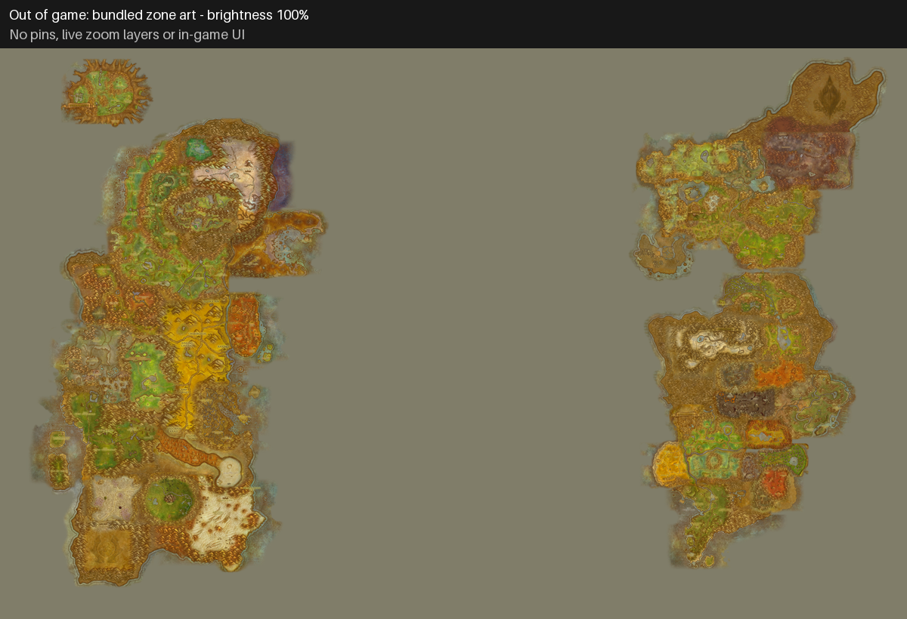
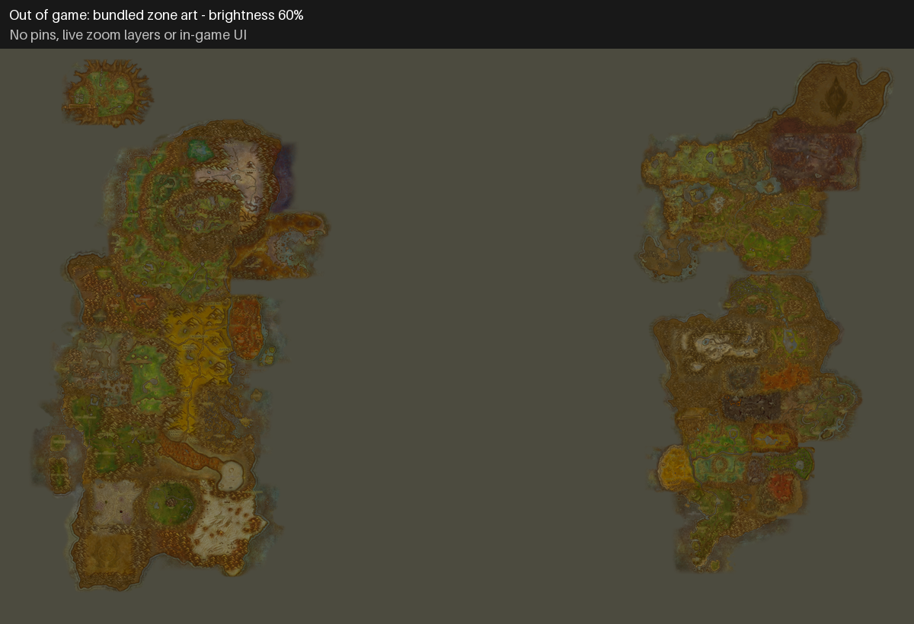

# Map brightness: out-of-game art comparison

These previews use OpenMap's bundled Forever zone tiles (Blizzard's map art), on the
preview renderer's sea colour. They show the brightness adjustment only. They omit
pins, live zoom fades, close-up terrain and the in-game UI; they are not screenshots
or a substitute for checking the map in game.

The full `tools/map-preview/render.py` preview needs the build's DB2 tables. When
those are unavailable, reproduce this limited comparison with:

```sh
python -P tools/map-preview/brightness.py docs/previews
```

Original brightness (100%, the default):



Dimmed art (60%):


